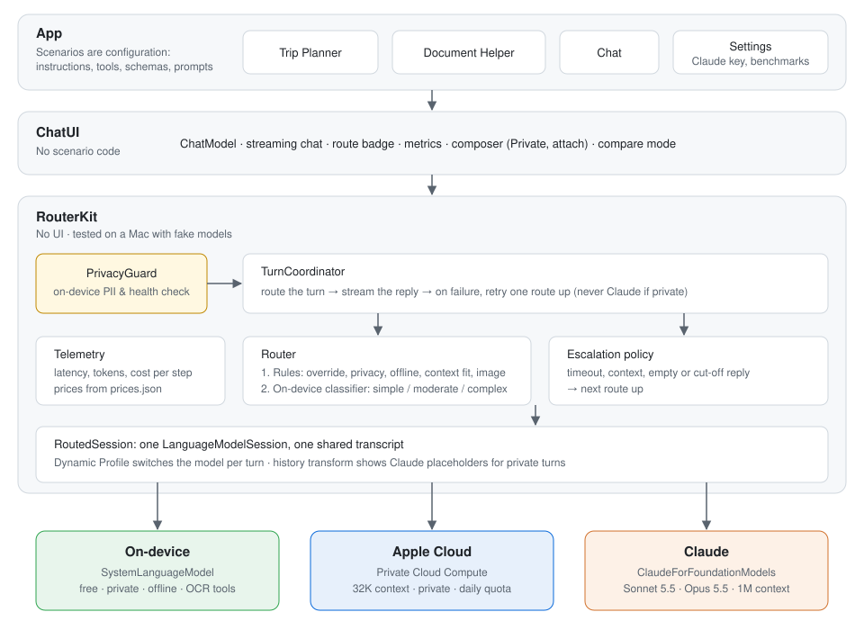

# HybridRouter

**Every turn of a conversation goes to the right model: Apple's on-device model, Apple's Private Cloud Compute, or Claude.**
One shared conversation moves between them without losing history. Private messages never leave Apple's models, and every reply shows where it ran, why, and what it cost.

<!-- Hero GIF: docs/gifs/hero.gif (recorded on device) -->

| Route | Model | Used for |
|---|---|---|
| On-device | Apple `SystemLanguageModel` | Quick, private or offline turns |
| Apple Cloud | Apple Private Cloud Compute | Longer context, multi-step plans |
| Claude | Claude Sonnet 5.5 / Opus 5.5 via [`ClaudeForFoundationModels`](https://github.com/anthropics/ClaudeForFoundationModels) | Judgment calls, trade-offs, code |

The core is a reusable Swift package, **RouterKit**, with no UI. The app shows it in three scenarios: a **Trip Planner** (brainstorm on-device, itineraries on Apple Cloud, trade-offs on Claude), a **Document Helper** (scan receipts and notes privately, summarize long documents, get negotiation advice), and plain **Chat**. **Compare mode** runs one prompt on all three routes side by side.



## How routing works

All three models implement Apple's `LanguageModel` protocol, so one `LanguageModelSession` with a Dynamic Profile switches models per turn while keeping one transcript. For each turn:

1. **PrivacyGuard** checks the message on-device: the Private toggle, scanned documents, card numbers (Luhn-checked), ID numbers, phone numbers, emails, addresses and health terms.
2. **Hard rules** settle the obvious cases, in order: your route override, privacy (never Claude), offline (on-device only), context fit (only models big enough for the conversation), images (a model that can see them), and bare follow-ups like "Why?" (stay with the model that answered).
3. **The on-device classifier** labels everything else as simple, moderate or complex, which maps to on-device, Apple Cloud or Claude. Each scenario can change the mapping.
4. **Escalation** retries a failed reply one route up: context too long, timeout, rate limit, decode failure, or an empty or cut-off reply. A private turn never escalates to Claude.

Each badge says why its reply went where it did ("Multi-step planning", "Kept private: scanned document", "Escalated: timed out"). Tap it for first-token time, tokens per second, tokens and cost.

## Privacy and security

- **Private turns stay with Apple.** Once a conversation has a private turn, Claude sees it, and every later turn answered by Apple's models, as "[Private message withheld]". This holds across escalation, follow-ups and session rebuilds, and is covered by tests that check the request Claude actually receives.
- **Scans are private by default.** OCR and barcode tools run only on Apple routes. Images that do go to Claude (non-private photos) are re-encoded without EXIF or GPS data.
- **No keys in the repo or the binary.** A key you paste is stored in the device's Keychain. Developer keys come only from a gitignored `Secrets.xcconfig` and are blanked in Release builds. Shipped builds use App Attest instead of a key. Keys never appear in logs, metrics or exports.
- **Secret scanning:** gitleaks runs in a pre-commit hook and in CI.

## Results

Routing accuracy against 50 hand-labeled prompts in `Evals/classifier_benchmark.json`. Apple ships different on-device model variants, and a prompt tuned on one doesn't transfer to the other, so the classifier uses instructions tuned per variant:

| Device | On-device model | Routed as labeled | Median time to classify |
|---|---|---|---|
| iPhone 17 Pro Max, iOS 27.0.1 | AFM 3 Core Advanced (8K context) | **46/50** | **628 ms** |
| MacBook Pro M1 Max, macOS 27.0 | AFM 3 Core (4K context) | **48/50** | ~900 ms |

Every miss routes one level higher than labeled (the safer direction), never lower. The same set also runs as an Apple [Evaluations](https://developer.apple.com/documentation/evaluations) framework evaluation (`Evals/AppleEvaluationTests.swift`), which scores 0.96 and writes an `.xcevalresult` you can open in Xcode.

<!-- Device results: run Settings › Developer › Measure routes and Routing benchmark on an iPhone and paste the Markdown tables here. -->

## Run it

```sh
git clone https://github.com/jaichaudhry/HybridRouter.git
open HybridRouter/HybridRouter.xcodeproj
```

Pick an iOS 27 simulator or device and run: no keys or accounts needed for the on-device model. Document Helper's OCR tools need a device; Apple doesn't include them in the Simulator. To run on your own iPhone, copy `Config/Secrets.example.xcconfig` to `Config/Secrets.xcconfig` and set `DEVELOPMENT_TEAM` and `HR_BUNDLE_ID`.

## Adding Claude in 30 seconds

Either:

- **In the app:** open Settings and paste an Anthropic API key. It's stored in the device's Keychain.
- **For development:** set `ANTHROPIC_API_KEY` in `Config/Secrets.xcconfig`, which is gitignored. Debug builds only; Release builds ignore it. Don't put keys in the scheme's environment variables: the scheme is shared and committed.

## Shipping with App Attest

For builds that run on other people's devices, don't embed a key. App Attest lets each install prove it's your genuine app and get short-lived Claude tokens:

1. In the [Claude Console](https://platform.claude.com/settings/workspaces/default/app-integrations), open your workspace's **App integrations** and create one with your Apple Team ID and bundle ID. You need the admin or owner role. Copy the client ID (`clid_…`).
2. Register an explicit App ID for your bundle ID with the App Attest capability.
3. In `Config/Secrets.xcconfig`, set `CLAUDE_CLIENT_ID` and `CODE_SIGN_ENTITLEMENTS = Config/AppAttest.entitlements` (or `Config/AppAttestAppleCloud.entitlements` if you also enabled Apple Cloud).
4. Set a spend limit for the workspace in the Claude Console, since every install's usage is billed to you.

App Attest only works on physical devices. In the Simulator, or if attestation fails, the app falls back to a key from Settings or `Secrets.xcconfig`. See Anthropic's [Apple Foundation Models guide](https://platform.claude.com/docs/en/cli-sdks-libraries/libraries/apple-foundation-models).

## Enabling Apple Cloud

Apple Cloud uses Apple's Private Cloud Compute. Apple grants its entitlement to developers in the App Store Small Business Program; see [Accessing Private Cloud Compute](https://developer.apple.com/private-cloud-compute/). Once your team has it, add to `Config/Secrets.xcconfig`:

```
HR_APPLE_CLOUD_ENABLED = YES
CODE_SIGN_ENTITLEMENTS = Config/AppleCloud.entitlements
```

(Use `Config/AppAttestAppleCloud.entitlements` instead if you also use App Attest.)

Without it, the app runs normally and shows Apple Cloud as unavailable. There's no API cost: each user's requests count against their own daily Apple Cloud allowance.

## Layout

```
Packages/RouterKit   Router, privacy, providers, routed session, Claude auth, telemetry. No UI.
Packages/ChatUI      Streaming chat, route badge, metrics, composer, compare mode.
App/                 The iOS app: scenarios, Settings, on-device benchmarks.
Evals/               Routing cases and the 50-prompt classifier benchmark.
Config/              Build settings; Secrets.xcconfig is yours and gitignored.
```

Run the tests on a Mac with Xcode 27:

```sh
swift test --package-path Packages/RouterKit
swift test --package-path Packages/ChatUI
swift test --package-path Evals
```

The router, privacy rules and shared session are tested with fake `LanguageModel`s running through Apple's real `LanguageModelSession`, so no device or network is needed. The evals check `Evals/routing_cases.json` against the router everywhere, and run the real on-device classifier wherever Apple Intelligence is available. To measure on a device, use **Settings › Developer**.

The project file is generated from `project.yml` with [XcodeGen](https://github.com/yonaskolb/XcodeGen). After changing `project.yml`, run `xcodegen generate`.

## Contributing

Install the gitleaks pre-commit hook after cloning:

```sh
brew install gitleaks
git config core.hooksPath .githooks
```

## License

[Apache-2.0](LICENSE)
