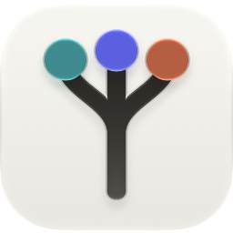
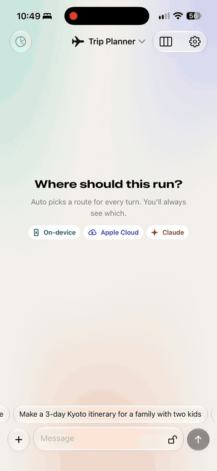
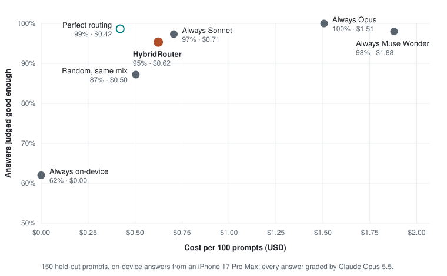
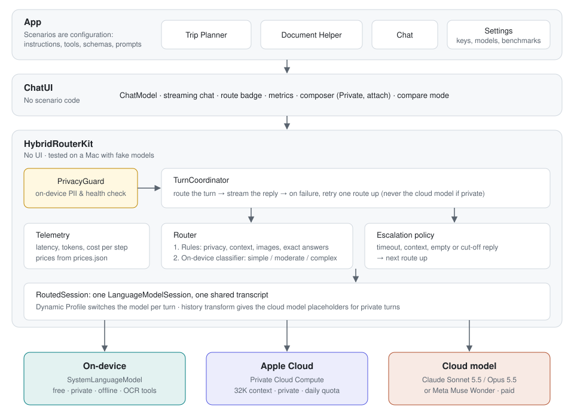

<div align="center">
  
  <h1>HybridRouter</h1>
  <p><b>Every message goes to the right model: on your iPhone, in Apple's private cloud, or Claude.</b></p>
  <p>
    <a href="https://github.com/jaichaudhry/HybridRouter/releases/latest"></a>
    <a href="https://github.com/jaichaudhry/HybridRouter/actions/workflows/ci.yml"></a>
    
    
    
    <a href="LICENSE"></a>
  </p>
  <p>
    <a href="#how-it-works">How it works</a> ·
    <a href="#results">Results</a> ·
    <a href="#use-hybridrouterkit-in-your-app">Swift package</a> ·
    <a href="#run-the-app">Run the app</a> ·
    <a href="#documentation">Docs</a>
  </p>
</div>

<p align="center">
  
  <br>
  <sub><i>An itinerary on Apple Cloud, a critique on Claude, a quick rewrite on-device. Every reply says where it ran, why and what it cost.</i></sub>
</p>

- **One conversation, three models.** Apple's on-device model, Apple Private Cloud Compute and a cloud model (Claude, or Meta's Muse Wonder) share a single transcript. Each turn goes to the one that fits it.
- **Private stays private.** Sensitive turns never reach the cloud model, even after retries or follow-ups. This is enforced in code and checked in tests.
- **Measured, not guessed.** Every reply shows its route, reason, speed and cost, and a benchmark grades routing on answer quality against cost.

| Route | Model | Used for | Cost |
|---|---|---|---|
|  **On-device** | Apple's on-device foundation model | Quick, private or offline turns | Free |
|  **Apple Cloud** | Apple Private Cloud Compute | Longer context, multi-step plans | Free |
|  **Cloud model** | Claude Sonnet 5.5 / Opus 5.5, or Muse Wonder | Judgment calls, trade-offs, code, exact answers | Paid |

## Results

On an iPhone 17 Pro Max, 150 held-out prompts were answered on every route and graded blind by Claude Opus. A person hand-checked 40 of the grades and agreed with 97%.

| | Good answers | Cost per 100 prompts | Stays on the phone |
|---|---|---|---|
| **HybridRouter** | **95%** | **$0.62** | **29%** |
| Always Claude Sonnet | 97% | $0.71 | 0% |
| Always on-device | 62% | free | 100% |

<p align="center">
  <picture>
    <source media="(prefers-color-scheme: dark)" srcset="docs/images/quality-dark.svg">
    
  </picture>
</p>

The router lands close to always-Claude quality while keeping about 3 in 10 messages on the phone. A rule that sends counting, arithmetic and date questions to the cloud added 6 points on 150 fresh test prompts. Perfect routing shows the remaining headroom: 99% at $0.42.

**→ [Full results, method and caveats](docs/results.md)**

## How it works

<p align="center">
  <picture>
    <source media="(prefers-color-scheme: dark)" srcset="docs/images/architecture-dark.svg">
    
  </picture>
</p>

For each message:

1. **Privacy check, on-device.** Card numbers, IDs, contact details, health terms, scans and the Private toggle mark a turn private.
2. **Rules** settle the clear cases: your chosen route, privacy, offline, context size, images, a model you name ("ask Claude"), and questions with one exact answer.
3. **The on-device classifier** labels everything else simple, moderate or complex, which maps to on-device, Apple Cloud or the cloud model.
4. **Failures** are retried once, then escalated one route up, or answered by a smaller model if nothing above can help. A private turn never reaches the cloud model.

All three models implement Apple's `LanguageModel` protocol, so one `LanguageModelSession` switches between them and keeps a single transcript.

**→ [How routing, privacy and the app work](docs/how-it-works.md)**

## Privacy

> [!IMPORTANT]
> Once a turn is private, the cloud model only ever sees `[Private message withheld]` in its place, across escalations, follow-ups and session rebuilds. Tests check the request it actually receives.

- Scanned documents are private by default, and OCR runs only on Apple's models.
- Keys live in the Keychain or a gitignored config, never in the repo or a Release build. Shipped builds use App Attest.
- gitleaks scans every commit, locally and in CI.

## Use HybridRouterKit in your app

```swift
.package(url: "https://github.com/jaichaudhry/HybridRouter", from: "0.4.0")
```

```swift
import HybridRouterKit

let assistant = HybridAssistant(
    instructions: "You are a helpful travel assistant.",
    cloud: .claude(apiKey: key)          // or .museWonder(apiKey:), or .off for Apple's models only
)
let reply = await assistant.respond(to: "Plan three days in Kyoto")
print(reply.decision?.reason ?? "", reply.text)   // "Multi-step planning", the itinerary
```

Privacy checks are on by default. Rate limits and dropped connections are retried, then fall back to a smaller model. For streaming, your own providers or custom rules, use `send(_:)` or build a `RoutedSession` and `TurnCoordinator` directly.

**New on `main`:** `HybridRouterKitVoice` adds on-device speech-to-text. The audio never leaves the phone, and the transcript is routed and privacy-checked like typing.

iOS 27 and macOS 27. `HybridRouterKitTesting` adds fake models, so routing and privacy rules can be unit-tested on a Mac without a device or network.

**→ [Install steps, a SwiftUI example, options and upgrading from 0.3](docs/hybridrouterkit.md)**

## Run the app

Requires Xcode 27 and an iOS 27 simulator or device with Apple Intelligence.

```sh
git clone https://github.com/jaichaudhry/HybridRouter.git
open HybridRouter/HybridRouter.xcodeproj
```

Run it. The on-device model needs no keys or accounts. Then try the three scenarios (Chat, Trip Planner and Document Helper) and Compare mode, which runs one prompt on every route side by side.

<details>
<summary><b>Add Claude, Muse Wonder or Apple Cloud</b></summary>

- **Claude:** paste an Anthropic API key in Settings, or set `ANTHROPIC_API_KEY` in the gitignored `Config/Secrets.xcconfig` for Debug builds.
- **Muse Wonder:** paste a Meta Model API key in Settings › Muse Wonder (or set `META_API_KEY`), then pick it under Settings › Cloud model.
- **Apple Cloud:** needs Apple's Private Cloud Compute entitlement. Until then, Debug builds can simulate it on-device.
- **Shipping:** use App Attest instead of an embedded key.

Step-by-step instructions are in **[Setup](docs/setup.md)**.

</details>

## FAQ

<details>
<summary><b>Why not send everything to Claude?</b></summary>

Cost, speed, privacy and offline use. Always-Sonnet scores 97%, against 95% for the router, but the router keeps about 3 in 10 messages on the phone: free, private, offline-capable and often faster to the first word. With Apple Cloud added, more turns can avoid paid calls entirely.

</details>

<details>
<summary><b>How is a "good answer" judged?</b></summary>

Claude Opus 5.5 grades each answer as good enough or not, against a written answer key where there is one, without knowing which model wrote it. A person blind-checked 40 grades and agreed with 97% of the ones they took a side on. Routing changes are tuned on 175 prompts and confirmed once on 150 fresh ones. See [Results](docs/results.md).

</details>

<details>
<summary><b>Where are the Apple Cloud numbers?</b></summary>

Apple's Private Cloud Compute entitlement is still pending for this project, so Apple Cloud is built and tested with fakes but not yet measured. If your team has the entitlement, you can add it to the results in about 15 minutes: see [issue #1](https://github.com/jaichaudhry/HybridRouter/issues/1).

</details>

<details>
<summary><b>How does Muse Wonder compare?</b></summary>

It passed 98% of the benchmark, between Claude Sonnet and Opus, but cost the most ($1.88 per 100 prompts) and took a median 9.3 s to its first word, against 2.2 s for Sonnet, because it reasons first and sends the whole reply at once.

</details>

> [!TIP]
> **Help wanted:** if your Apple developer team has the Private Cloud Compute entitlement, you can add the missing Apple Cloud numbers in about 15 minutes. See [issue #1](https://github.com/jaichaudhry/HybridRouter/issues/1).

## Documentation

| Page | What's in it |
|---|---|
| [How it works](docs/how-it-works.md) | Routing steps, privacy guarantees, the app tour, Apple APIs used |
| [Results](docs/results.md) | Quality vs cost, routing improvements, classifier accuracy, speed per route |
| [HybridRouterKit](docs/hybridrouterkit.md) | Using the Swift package in your app |
| [Setup](docs/setup.md) | Keys, Muse Wonder, App Attest, Apple Cloud, project layout and tests |
| [Engineering notes](docs/engineering-notes.md) | What testing on real hardware turned up |

## License

[Apache-2.0](LICENSE). Contributions welcome: install the gitleaks hook with `git config core.hooksPath .githooks` after cloning.
