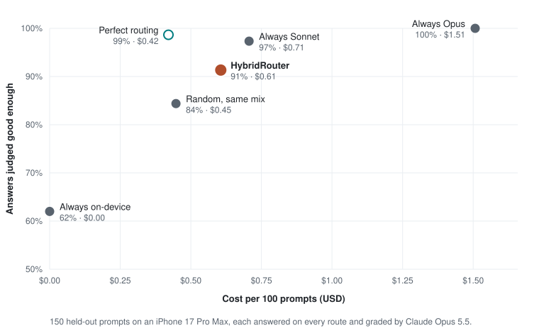

# HybridRouter

[](https://github.com/jaichaudhry/HybridRouter/actions/workflows/ci.yml)


[](LICENSE)

**Every turn of a conversation goes to the right model: Apple's on-device model, Apple's Private Cloud Compute, or Claude.**
One shared conversation moves between them without losing history. Private messages never leave Apple's models, and every reply shows where it ran, why, and what it cost.

<p align="center">
  
  <br>
  <sub>iPhone 17 Pro Max · itinerary on Apple Cloud (simulated while the entitlement is pending) → critique on Claude → rewrite on-device. Waits are sped up.</sub>
</p>

| Route | Model | Used for |
|---|---|---|
| On-device | Apple `SystemLanguageModel` | Quick, private or offline turns |
| Apple Cloud | Apple Private Cloud Compute | Longer context, multi-step plans |
| Claude | Claude Sonnet 5.5 / Opus 5.5 via [`ClaudeForFoundationModels`](https://github.com/anthropics/ClaudeForFoundationModels) | Judgment calls, trade-offs, code |

The cloud route can be served by Meta's **Muse Wonder** instead of Claude (Settings › Cloud model). It uses the same bridge, pointed at Meta's Anthropic-compatible endpoint, and the same routing and privacy rules.

## What this demonstrates

- **Three model providers behind one conversation.** All three implement Apple's `LanguageModel` protocol, so a single `LanguageModelSession` with a Dynamic Profile switches models per turn and keeps one transcript.
- **A router you can read and test.** Hard rules (privacy, offline, context size, images) run first; an on-device classifier labels everything else; failures escalate one route up. The rules are pure functions, and the routing, session and privacy code has 98% line coverage.
- **Privacy enforced in code, not policy.** An on-device PrivacyGuard flags sensitive turns, and Claude only ever sees placeholders for them, even after escalations, follow-ups or a session rebuild. Tests check the request Claude actually receives.
- **Routing measured on answer quality, not just labels.** 150 held-out prompts are answered on every route and graded by Claude Opus (hand-checked against a person: 97% agreement), so the router is scored on quality versus cost against always-Claude, random and perfect routing. A 50-prompt labeled benchmark tuned the classifier and showed it needs different instructions per on-device model variant.
- **Cost and latency on every reply.** Each badge shows the route and reason, and a line under each finished reply shows first-token time, tokens per second and cost; tapping either shows the full metrics. A session summary compares the cost with sending everything to Claude.
- **Routing you can see.** Each route has its own color and symbol (teal On-device, indigo Apple Cloud, terracotta Claude, chosen for contrast and color blindness). The badge shows the router deciding, escalations stay visible as a struck-through trail, and a reply still waiting on a slower route can switch to on-device with one tap.
- **Production details.** Swift 6 strict concurrency with zero warnings, Keychain storage, App Attest for shipped builds, gitleaks in a pre-commit hook and CI, Dynamic Type, VoiceOver and iPad layouts.

## Tour

The app has three scenarios, picked from the title bar. It opens in Chat, then reopens wherever you were last. Sample prompts appear as chips above the composer.

| Scenario | Try | Where it goes |
|---|---|---|
| **Chat** | "Give me three dinner ideas" | On-device |
| | "Explain how vaccines work in two paragraphs" | Apple Cloud (Claude when Apple Cloud isn't available) |
| | "Which is better for a beginner, Swift or Kotlin, and why?" | Claude |
| **Trip Planner** | "Give me 5 weekend trip ideas from Seattle" | On-device (or Apple Cloud on newer iPhones) |
| | "Make a 3-day Kyoto itinerary for a family with two kids" | Apple Cloud, rendered as day cards |
| | "Is this plan realistic with jet lag and a 4-year-old? What would you cut?" | Claude |
| | "Rewrite day 2 as a short text to my partner" | On-device |
| **Document Helper** | Scan a receipt, then "Extract the total and merchant" | On-device, kept private, rendered as a receipt card |
| | Import a contract, then "Summarize the key risks" | Claude, or Apple Cloud if it's private |

- **The composer** has a "+" menu for attachments (photos, the document scanner, text or PDF files) and the route (Auto, On-device, Apple Cloud, Claude), and a Private lock in the message field.
- **Compare mode** (toolbar) runs one prompt on all three routes side by side, with each route's speed and cost.
- **Settings › Developer** has the tools that produced the results below: a routing benchmark, per-route measurements, Apple Cloud checks, and (in Debug builds) a simulated Apple Cloud for developing without Apple's entitlement.


## How routing works

For each turn:

1. **PrivacyGuard** checks the message on-device: the Private toggle, scanned documents, card numbers (Luhn-checked), ID numbers, phone numbers, emails, addresses and health terms.
2. **Hard rules** settle the obvious cases, in order: your route override, privacy (never Claude), offline (on-device only), context fit (only models big enough for the conversation), images (a model that can see them), a model you name in the message ("ask Claude"), and bare follow-ups like "Why?" (stay with the model that answered). Each model is also told it shares the conversation with the other two, so it doesn't deny that Claude exists when you ask for it.
3. **The on-device classifier** labels everything else as simple, moderate or complex, which maps to on-device, Apple Cloud or Claude. Each scenario can change the mapping, and each on-device model variant gets its own tuned instructions.
4. **Escalation** retries a failed reply one route up: context too long, timeout, rate limit, decode failure, or an empty or cut-off reply. A private turn never escalates to Claude.

Each badge says why its reply went where it did ("Multi-step planning", "Kept private: scanned document", "Escalated: timed out").

## Privacy and security

- **Private turns stay with Apple.** Once a conversation has a private turn, Claude sees it, and every later turn answered by Apple's models, as "[Private message withheld]". This holds across escalation, follow-ups and session rebuilds, and is covered by tests that check the request Claude actually receives.
- **Scans are private by default.** OCR and barcode tools run only on Apple routes. Images that do go to Claude (non-private photos) are re-encoded without EXIF or GPS data.
- **No keys in the repo or the binary.** A key you paste is stored in the device's Keychain. Developer keys come only from a gitignored `Secrets.xcconfig` and are blanked in Release builds. Shipped builds use App Attest instead of a key. Keys never appear in logs, metrics or exports.
- **Secret scanning:** gitleaks runs in a pre-commit hook and in CI.

## Results

### Quality vs cost

Does routing keep answers good while spending less? On an iPhone 17 Pro Max, each of 150 held-out prompts (chat, trip planning and pasted documents, none used while tuning the router) was answered on-device, by Claude Sonnet, by Claude Opus and by Meta's Muse Wonder. Claude Opus 5.5 graded every answer, without knowing which model wrote it, as good enough or not. Each strategy is then scored on the answers it would have given:

<p align="center">
  
</p>

| Strategy | Answers good enough | Cost per 100 prompts | Sent to Claude |
|---|---|---|---|
| **HybridRouter** | **91%** | **$0.61** | 63% |
| Always on-device | 62% | $0 | 0% |
| Always Claude Sonnet | 97% | $0.71 | 100% |
| Always Claude Opus (reference) | 100% | $1.51 | 100% |
| Always Muse Wonder (Meta) | 98% | $1.88 | 0% |
| Random, same mix as the router | 84% | $0.45 | 63% |
| Perfect routing (cheapest route that passed) | 99% | $0.42 | 38% |

- **The router beats chance.** It closes 83% of the quality gap between always-on-device and always-Claude, 7 points above random routing with the same share of Claude.
- **It doesn't yet save much against Sonnet alone:** 14% cheaper for 6 points less. Perfect routing would keep 99% for 41% less, so there's headroom.
- **Against always-Opus it's 60% cheaper, but mostly because Sonnet costs half as much.** With Opus as the router's Claude tier (the same routing decisions, scored on the Opus answers), it would pass 93% at $1.28 per 100 prompts: 15% cheaper than always-Opus. So routing itself saves about 15% whichever Claude sits on top, and perfect routing would save 42% with Opus at no loss in quality.
- **Muse Wonder matches the top tier but costs the most and answers slowest.** It passed 98%, between Sonnet and Opus, and got 4 prompts right that Sonnet missed. But it reasons at length before answering, so it costs more than Opus at the same list price ($1.88 per 100 prompts, 27% more output) and took a median 9.3 s to the first word, against 2.2 s for Sonnet; Meta's Anthropic-compatible endpoint sends the whole reply at once. With Muse as the router's cloud tier, the router would pass 92% at $1.51 per 100 prompts.
- **Most of the gap is over-routing.** 48 of the 150 prompts went to Claude when the on-device answer was already good enough, mostly summaries, rewrites, explainers and short code.
- **The 9 quality misses are mostly prompts that look easy but aren't** for a small model: counting letters, date arithmetic, time zones, word counts and scaling a recipe.

**Checking the judge.** A model grading models can be wrong or favor its own answers, so 40 verdicts, mixed across routes and passes and fails, were hand-checked blind to which model wrote each answer. The checker agreed on 35 and disagreed on 1, a borderline time-zone answer the judge failed as misleading: 97% of the calls they took a side on, or 88% counting the 4 they weren't sure about.

Caveats: Apple Cloud isn't in this run, because the Private Cloud Compute entitlement is pending, so its turns went to Claude as in the shipped app. Muse Wonder was added afterwards from a Mac (its answers don't depend on the device) and graded by the same judge; the hand check above predates it, and a Claude judge may favor Claude-style answers. Its first pass exposed an app bug: told it was one of three models, Muse signed replies "I'm Muse Wonder", which the judge failed as an invented identity. The note now says to mention the model only when asked, and Muse was re-run; the other models had almost never repeated it (Sonnet once in 175 answers, Opus never), so they weren't. Costs are API list prices for answers only; the runs reported here cost $13.46 in total, judging included. Full answers, verdicts and every misrouted prompt are in [`Evals/results/`](Evals/results/2026-10-14-iphone-quality-muse.md).

### Routing accuracy

Routing accuracy against 50 hand-labeled prompts in `Evals/classifier_benchmark.json`. Apple ships different on-device model variants, and a prompt tuned on one doesn't transfer to the other, so the classifier uses instructions tuned per variant:

| Device | On-device model | Routed as labeled | Median time to classify |
|---|---|---|---|
| iPhone 17 Pro Max, iOS 27.0.1 | AFM 3 Core Advanced (8K context) | **46/50** | **628 ms** |
| MacBook Pro M1 Max, macOS 27.0 | AFM 3 Core (4K context) | **48/50** | ~900 ms |

Every miss routes one level higher than labeled (the safer direction), never lower.

Speed and cost per route on an iPhone 17 Pro Max (iOS 27.0.1), median of three prompts each (Settings › Developer › Measure routes):

| Route | Model | First token | Tokens/sec | Cost per reply |
|---|---|---|---|---|
| On-device | AFM 3 Core Advanced | 368 ms | 63 | $0 |
| Apple Cloud | Private Cloud Compute | not measured yet (needs Apple's entitlement) | | |
| Claude | Sonnet 5.5 | 1,030 ms | 89 | $0.0047 |

Route mix for each scenario's sample conversation on Auto, same iPhone, with Apple Cloud simulated on-device while the Private Cloud Compute entitlement is pending. Routing decisions and Claude costs are real; Apple Cloud has no API cost either way.

| Scenario | On-device | Apple Cloud | Claude | Cost | All on Claude | Saved |
|---|---|---|---|---|---|---|
| Trip Planner (7 turns) | 29% | 43% | 29% | $0.034 | $0.054 | 37% |
| Chat (3 turns) | 33% | 33% | 33% | $0.0058 | $0.0078 | 26% |

Without Apple Cloud at all, its turns move up to Claude: the Trip Planner then ran 86% on Claude for $0.092. The same set also runs as an Apple [Evaluations](https://developer.apple.com/documentation/evaluations) framework evaluation (`Evals/AppleEvaluationTests.swift`), which scores 0.96 and writes an `.xcevalresult` you can open in Xcode.


## APIs and frameworks used

| API | What it does here | Where |
|---|---|---|
| `LanguageModel`, `LanguageModelSession` | One session and transcript shared by all three models | `HybridRouterKit/Session/RoutedSession.swift` |
| Dynamic Profiles (`DynamicProfile`, `@SessionProperty`, `.model`, `.historyTransform`) | Switch the model per turn; withhold private turns from Claude | `HybridRouterKit/Session/RoutingProfile.swift` |
| `SystemLanguageModel` (`availability`, `contextSize`, `tokenCount(for:)`, `variant`) | On-device route, token estimates for context fit, per-variant tuning | `HybridRouterKit/Providers/OnDeviceProvider.swift`, `Routing/TokenEstimator.swift` |
| `PrivateCloudComputeLanguageModel` (`availability`, `quotaUsage`, `contextSize`) | Apple Cloud route, quota-aware | `HybridRouterKit/Providers/AppleCloudProvider.swift` |
| `@Generable`, `@Guide`, streaming partial results | The routing classifier; itinerary, receipt and summary cards that fill in while streaming | `Routing/RouteClassification.swift`, `App/Scenarios/` |
| `Tool` | Trip Planner's `findPlaces` | `App/Scenarios/TripPlanner/PlacesTool.swift` |
| `Attachment` (images), `OCRTool`, `BarcodeReaderTool` | Reading scanned receipts and notes on Apple routes only | `RoutedSession.swift`, `App/Scenarios/DocumentHelper/` |
| `LanguageModelSession.Usage`, `LanguageModelError` | Per-step tokens and cost; failure causes for escalation | `Telemetry/`, `Routing/EscalationPolicy.swift` |
| Evaluations framework | The classifier benchmark as an Apple evaluation | `Evals/AppleEvaluationTests.swift` |
| `ClaudeLanguageModel`, `ClaudeModel`, `AuthMode`, App Attest | Claude route; API key or App Attest auth | `HybridRouterKit/Providers/ClaudeProvider.swift`, `Auth/` |
| `NSDataDetector`, regular expressions | On-device PII detection | `HybridRouterKit/Privacy/PrivacyGuard.swift` |
| VisionKit, PDFKit, PhotosUI | Document scanner, PDF import, photo picker | `ChatUI/DocumentScanner.swift`, `ChatAttachment.swift`, `Composer.swift` |
| Keychain, DeviceCheck, Network | Key storage, App Attest support check, offline detection | `Auth/KeychainStore.swift`, `App/AppConfig.swift`, `Routing/NetworkMonitor.swift` |
| Observation, `Synchronization.Mutex`, Swift Testing | Swift 6 concurrency without locks; tests | throughout |

## Using HybridRouterKit in your app

HybridRouterKit is a Swift package (iOS 27, macOS 27) with no UI. Add this repository as a package dependency and pick the `HybridRouterKit` library:

```swift
.package(url: "https://github.com/jaichaudhry/HybridRouter", from: "0.1.0")
```

```swift
import HybridRouterKit

/// One conversation that routes each turn between the on-device model, Apple Cloud and Claude.
@MainActor
final class Assistant {
    let session: RoutedSession
    let coordinator: TurnCoordinator
    private let network = NetworkMonitor()

    init(claudeAPIKey: String?) throws {
        let claudeAuth = ClaudeAuthSource.resolve(
            environment: ClaudeAuthEnvironment(
                clientID: nil,                // or your Claude Console client ID for App Attest
                isPhysicalDevice: true,
                isAppAttestSupported: false,
                developerKey: nil,
                allowsDeveloperKey: false
            ),
            userKey: claudeAPIKey
        )
        session = RoutedSession(
            instructions: "You are a helpful travel assistant.",
            onDevice: OnDeviceProvider(),
            appleCloud: AppleCloudProvider(isEnabled: false), // true once your team has the PCC entitlement
            claude: ClaudeProvider(auth: claudeAuth),
            costTable: try CostTable.bundled()
        )
        let network = network
        coordinator = TurnCoordinator(
            router: Router(classifier: OnDeviceClassifier()),
            estimator: OnDeviceTokenEstimator(),
            isOnline: { network.isOnline }
        )
    }

    /// Checks privacy on-device, routes the turn, streams the reply, and escalates on failure.
    func send(_ prompt: String) async -> String {
        let privacy = PrivacyGuard().assess(prompt)
        let outcome = await coordinator.run(
            .init(prompt: prompt, privacyReason: privacy?.label),
            in: session
        ) { event in
            if case .partial(let content) = event {
                print(content.text) // the reply so far
            }
        }
        if let decision = outcome.decision, let metrics = outcome.steps.last {
            print("\(decision.route.displayName): \(decision.reason), \(metrics.estimatedCost ?? 0) USD")
        }
        return outcome.content?.text ?? outcome.failure ?? ""
    }
}
```

`HybridRouterKitTesting` adds fake models and a fake classifier, so your routing and privacy rules can be unit-tested on a Mac without a device or network. HybridRouterKit is pre-1.0: its API may change, and it depends on Anthropic's beta `ClaudeForFoundationModels`.

## Engineering notes

Things found by testing on real hardware, and what the app does about them:

- **Prompts don't transfer between on-device model variants.** The routing instructions tuned on a Mac's AFM 3 Core (4K context) scored 48/50; on an iPhone 17 Pro Max's AFM 3 Core Advanced (8K) they scored 42/50, every miss one level too high. The classifier now picks instructions per variant (46/50 on the iPhone).
- **The on-device model can loop on tool calls.** Given a tool and an output schema, it called `findPlaces` over and over until the context overflowed. Asking it to call the tool once, and saying so in the tool's output, fixed it.
- **An overflow mid-generation doesn't throw the documented error.** It throws a non-public `GenerativeError`, not `LanguageModelError.contextSizeExceeded`, so escalation also matches it by message.
- **Claude refusals and length cut-offs don't throw** through the bridge; the reply just comes back empty or short. The router treats an empty reply as a failure and flags cut-off replies.
- **The iOS Simulator has no `OCRTool` or `BarcodeReaderTool`.** Its SDK doesn't include their overlay, so Document Helper's image tools are compiled in for devices only.
- **Context can mislead the classifier.** Showing it the previous message for every short turn made "Make a packing list for the kids" inherit "complex" from a trade-offs question before it. Context is now added only when a message refers back ("do the same for Osaka").
- **Generating a reason is expensive.** A free-text reason added about 600 ms per classification on an M1 Max, so the badge's reason is derived from the labels instead.

## Setup

### Run it

```sh
git clone https://github.com/jaichaudhry/HybridRouter.git
open HybridRouter/HybridRouter.xcodeproj
```

Pick an iOS 27 simulator or device and run: no keys or accounts needed for the on-device model. Document Helper's OCR tools need a device; Apple doesn't include them in the Simulator. To run on your own iPhone, copy `Config/Secrets.example.xcconfig` to `Config/Secrets.xcconfig` and set `DEVELOPMENT_TEAM` and `HR_BUNDLE_ID`.

### Adding Claude in 30 seconds

Either:

- **In the app:** open Settings and paste an Anthropic API key. It's stored in the device's Keychain.
- **For development:** set `ANTHROPIC_API_KEY` in `Config/Secrets.xcconfig`, which is gitignored. Debug builds only; Release builds ignore it. Don't put keys in the scheme's environment variables: the scheme is shared and committed.

### Using Muse Wonder instead

Create a key at [dev.meta.ai](https://dev.meta.ai/api-keys) (Standard mode, so your prompts aren't used for training). Then either paste it in Settings › Muse Wonder, or set `META_API_KEY` in `Config/Secrets.xcconfig` for Debug builds, and pick **Muse Wonder** under Settings › Cloud model. Replies are labelled with the model that wrote them, so a conversation can switch back and forth. Expect slower replies than Claude: Muse reasons before answering and its reply arrives all at once, a median 9.3 s to the first word against 2.2 s for Sonnet (see [Quality vs cost](#quality-vs-cost)). Meta has no App Attest equivalent, so for other people's devices each user brings their own key.

### Shipping with App Attest

For builds that run on other people's devices, don't embed a key. App Attest lets each install prove it's your genuine app and get short-lived Claude tokens:

1. In the [Claude Console](https://platform.claude.com/settings/workspaces/default/app-integrations), open your workspace's **App integrations** and create one with your Apple Team ID and bundle ID. You need the admin or owner role. Copy the client ID (`clid_…`).
2. Register an explicit App ID for your bundle ID with the App Attest capability.
3. In `Config/Secrets.xcconfig`, set `CLAUDE_CLIENT_ID` and `CODE_SIGN_ENTITLEMENTS = Config/AppAttest.entitlements` (or `Config/AppAttestAppleCloud.entitlements` if you also enabled Apple Cloud).
4. Set a spend limit for the workspace in the Claude Console, since every install's usage is billed to you.

App Attest only works on physical devices. In the Simulator, or if attestation fails, the app falls back to a key from Settings or `Secrets.xcconfig`. See Anthropic's [Apple Foundation Models guide](https://platform.claude.com/docs/en/cli-sdks-libraries/libraries/apple-foundation-models).

### Enabling Apple Cloud

Apple Cloud uses Apple's Private Cloud Compute. Apple grants its entitlement to developers in the App Store Small Business Program; see [Accessing Private Cloud Compute](https://developer.apple.com/private-cloud-compute/). Once your team has it, add to `Config/Secrets.xcconfig`:

```
HR_APPLE_CLOUD_ENABLED = YES
CODE_SIGN_ENTITLEMENTS = Config/AppleCloud.entitlements
```

(Use `Config/AppAttestAppleCloud.entitlements` instead if you also use App Attest.)

Without it, the app runs normally and shows Apple Cloud as unavailable. There's no API cost: each user's requests count against their own daily Apple Cloud allowance.

While you wait for the entitlement, Debug builds have **Settings › Developer › Simulate Apple Cloud**, which serves the Apple Cloud route with the on-device model so you can try the three-route flow. Those replies are labeled "Apple Cloud (simulated)" and say nothing about Apple Cloud's real speed or quality. The option doesn't exist in Release builds.

## Project layout and tests

```
Packages/HybridRouterKit   Router, privacy, providers, routed session, Claude auth, telemetry. No UI.
Packages/ChatUI      Streaming chat, route badge, metrics, composer, compare mode.
App/                 The iOS app: scenarios, Settings, on-device benchmarks and checks.
Evals/               Routing cases, the classifier benchmark, the answer-quality benchmark and its results, the Apple evaluation.
Config/              Build settings; Secrets.xcconfig is yours and gitignored.
```

Run the tests on a Mac with Xcode 27:

```sh
swift test --package-path Packages/HybridRouterKit
swift test --package-path Packages/ChatUI
swift test --package-path Evals
```

The router, privacy rules and shared session are tested with fake `LanguageModel`s running through Apple's real `LanguageModelSession`, so no device or network is needed. The evals run the real on-device classifier wherever Apple Intelligence is available and are skipped elsewhere, including CI.

The answer-quality benchmark calls Claude, so it only runs when asked. On an iPhone, use **Settings › Developer › Answer quality**; on a Mac, with a key in `Config/Secrets.xcconfig` (about $9 for the full set, capped at $15):

```sh
HR_RUN_QUALITY_EVAL=1 swift test --package-path Evals --filter answerQuality
```

The project file is generated from `project.yml` with [XcodeGen](https://github.com/yonaskolb/XcodeGen). After changing `project.yml`, run `xcodegen generate`.

## Status

- On-device and Claude routes: complete and measured on device.
- Apple Cloud: built and tested with fakes and a simulated stand-in; real measurements are waiting on Apple's Private Cloud Compute entitlement. **Settings › Developer › Apple Cloud checks** will verify it in one tap.

## Contributing

Install the gitleaks pre-commit hook after cloning:

```sh
brew install gitleaks
git config core.hooksPath .githooks
```

## License

[Apache-2.0](LICENSE)
